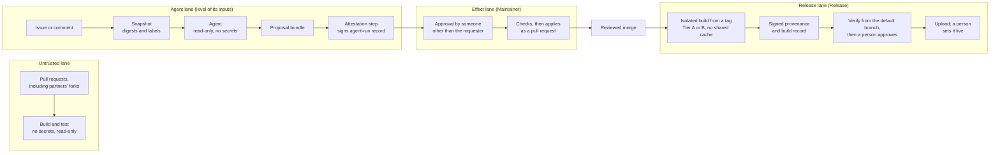

# Open Build and Agent Assurance Framework (OBAAF)

OBAAF is intended to be a free, open framework for keeping malicious code out of the software updates people install. It secures the build pipelines that produce those updates, and the AI agents now connected to them. Version 1 starts with independent game studios, whose updates reach phones, PCs and consoles and whose teams rarely include security staff.

> **Status: version 0.1, draft, private.** Nothing here has been piloted, and no license is granted yet. This repository stays private, and nothing in it is released or submitted, until the author's employer approves the release in writing. The specifications and tools are built only from public standards and public documentation. See [LICENSING.md](LICENSING.md).
>
> The draft awaits maintainer review. Proposed design decisions are tracked in [DECISIONS.md](DECISIONS.md).

## What is here

| Component | What it does | Where |
| --- | --- | --- |
| Game-pipeline integrity profile | 28 requirements in nine control families that tailor NIST's SSDF and SLSA to game builds, each with a test and its mappings | [spec/profile.md](spec/profile.md) |
| Agent controls | Taint-bounded authority, eight requirements (R1–R8), a three-lane architecture and a signed record of each agent run | [spec/agent-controls.md](spec/agent-controls.md) |
| Self-assessment | 34 yes-or-no questions in four tiers that give a tier and a ranked list of fixes, on paper, in an offline form, or from the command line | [spec/self-assessment.md](spec/self-assessment.md), [offline form](assessment/obaaf-self-assessment.html) |
| Reference pipeline templates | GitHub Actions workflows for four lanes: untrusted contributions, agents, approved changes and releases | [templates/github-actions](templates/github-actions/README.md) |
| Verification tools | A pipeline checker that flags risky workflow settings; a release verifier that blocks uploads without valid provenance, approvals and agent records; and checks on an agent's signed record and proposal before anything is applied | [spec/checker-rules.md](spec/checker-rules.md), `obaaf verify release`, `obaaf verify agent-run`, `obaaf proposal check` |

The profile, the agent controls and the self-assessment come from the author's two companion papers, both unpublished drafts:

- **Paper 1**, [*Untrusted Text, Trusted Tokens*](papers/OBAAF-Paper1-Agent-Assurance-LaTeX/README.md): agent assurance, the source of the agent controls.
- **Paper 2**, [*Securing the Game Build*](papers/OBAAF-Paper2-Build-Assurance-Games-LaTeX/README.md): build assurance for games, the source of the profile and the self-assessment.

Their machine-readable form in [`src/obaaf/data/`](src/obaaf/data/) is the single source of truth: the documents in `spec/` and the offline form are generated from it.

## How it fits together



## Quick start

OBAAF needs Python 3.10 or later.

```bash
python -m pip install -e ".[keys]"
obaaf --help
```

**Studios.** Start with the self-assessment. Open [the offline form](assessment/obaaf-self-assessment.html) in a browser, or:

```bash
obaaf assess init --output answers.yaml   # fill in yes, no or na
obaaf assess score answers.yaml           # your tier and what to fix first
```

Your answers never leave your machine. Then follow [the adoption guide](docs/adoption-guide.md).

**Build engineers.** Check your workflows, then install the templates:

```bash
obaaf check path/to/your/repository
obaaf templates install --dest path/to/your/repository --obaaf-repo OWNER/obaaf --obaaf-sha <commit>
```

**Reviewers.** Read [the architecture](docs/architecture.md), [the decisions log](DECISIONS.md), and [how each requirement is tested](docs/traceability.md).

## Tests

```bash
python -m unittest discover -s tests -v
obaaf docs build --check   # the generated documents match the data
obaaf catalog              # the data files agree with each other
```

Each functional requirement of the specification (FR1–FR12) has an offline test module. Some acceptance criteria can only be shown on a real GitHub repository, such as a fork's pull request being denied secrets: for those, the offline tests check the templates and tools, and the [live acceptance tests](docs/live-acceptance-tests.md), which have not been run yet, check the platform. [Traceability](docs/traceability.md) gives the status of each requirement, including the ones version 0.1 meets only in part.

## Project documents

- [DECISIONS.md](DECISIONS.md): every design decision, its reason and its status
- [CHANGELOG.md](CHANGELOG.md): changes by version
- [CONTRIBUTING.md](CONTRIBUTING.md): contribution rules and review responsibilities
- [SECURITY.md](SECURITY.md): how to report a vulnerability
- [LICENSING.md](LICENSING.md): intended licenses and the release condition

Software project attribution: [Ofonna Nweze](https://github.com/Ofonna-N) and [Osita Sean Keluo-Udeke](https://github.com/seanudeke).

Both contributors maintain the project. The Python package metadata credits both names.

The companion research papers are the independent work of Osita Sean Keluo-Udeke. The project does not imply endorsement by any government agency or by the research author's employer.
