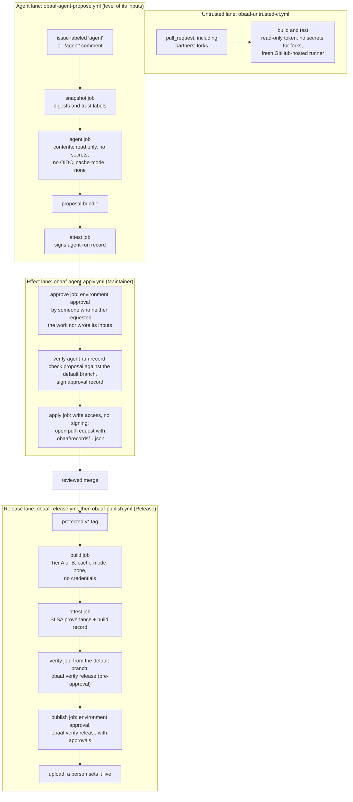

# Architecture

OBAAF has five components. The profile, the agent controls and the self-assessment are specifications, kept as data in `src/obaaf/data/`. The templates and the tools put them into practice. A studio can adopt each component on its own.

## The threat it addresses

Whoever controls a build pipeline controls what millions of devices install next. Papers 1 and 2 document how attackers have used that position:

| Path | Example | OBAAF's answer |
| --- | --- | --- |
| AP1 Build environment | 2019 game build compromises, SUNSPOT, 3CX | A separate, isolated release lane; provenance checked before upload; independent rebuilds (F3, F4, F7) |
| AP2 Signing material | Winnti, APT41 | Keys held in hardware, a key service or platform signing (F5) |
| AP3 Publishing or update channel | Steamworks accounts, Downfall mod | Dedicated upload identities, MFA, alerts, a person sets builds live (F6) |
| AP4 Third-party component | SpinOk | A binary manifest and SDK review (F2) |
| Agents steered by outside text | Clinejection, PromptPwnd, Amazon Q | Taint-bounded authority, three lanes and signed agent-run records (F8, R1–R8) |
| Outside text run as code in a privileged workflow | Nx "s1ngularity" (shell injection, not an agent; Paper 1 includes it because the mismatch is the same) | Untrusted text passed as data, never interpolated into scripts (rule 010; R1–R3) |

The agent adversaries are A1, an outside author; A2, an upstream supplier; and A3, a low-privilege insider (Paper 1, section 3.3).

## Lanes

Work is split into lanes, each a separate job or workflow with its own identity, so the CI platform, not the agent or the build, enforces the boundaries.



## What enforces what

"Checked by" lists the offline checks that run today and the live acceptance test that is meant to confirm the platform behavior. None of the live tests has been run yet ([live-acceptance-tests.md](live-acceptance-tests.md)); [traceability.md](traceability.md) gives each requirement's status.

| Property | Enforced by | Checked by |
| --- | --- | --- |
| Fork pull requests get no secrets and a read-only token (FR3) | GitHub, with the repository settings in [github-settings.md](github-settings.md) | `obaaf check` rules 001, 002, 009, 010, 013, 019 (statically); live test LAT-03 |
| Release builds start from protected tags, read no shared cache and state their tier; publishing requires the tagged commit to be on the protected branch (FR4) | tag ruleset; `cache-mode: none`; the workflow definition; the publish workflow's ancestry check | `obaaf check` rules 006, 007, 013, 015; `obaaf verify release`; the build record; LAT-04 |
| Every artifact has signed provenance naming source, assets, manifest, SDKs, workflow and builder (FR5) | the attest job | `obaaf verify release`; rule 017; LAT-05 |
| Uploads stop without provenance, approvals or agent records (FR6) | the publish workflow, which runs from the default branch | `obaaf verify release`; rules 014, 016; LAT-06 |
| Agents read a recorded snapshot and hold read-only access, no secrets, no cloud credentials (FR7) | job permissions; the snapshot job | `obaaf check` rules 004, 005, 011, 020; the agent-run record; LAT-07. Egress is not enforced by default (see traceability) |
| No agent can write; every applied change has an approval by someone other than the requester (FR8) | job permissions; environment with self-review prevention; the split effect lane | `obaaf check` rules 003, 009, 021, 022; `obaaf verify agent-run`; `obaaf proposal check`; the approval record; LAT-08 |
| Instructions come only from the protected base branch (FR9) | the agent job's checkout; CODEOWNERS | `obaaf check` rules 012, REPO-001, REPO-002, INS-001; LAT-09 |
| Tools pinned by digest; each run signed and valid against the schema (FR10) | SHA-pinned actions; the attest job | `obaaf check` rules 008, 021; schema validation; LAT-10. Models are not yet pinned (see traceability) |
| No build step can read a signing key (FR11) | Sigstore signing of attestations in jobs without build code | `obaaf check` rule 018; LAT-11. Code signing of shipped binaries is a marked step in the publish workflow that v0.1 does not implement |

## Trust levels

Principals are ordered Public ⊑ Contributor ⊑ Maintainer ⊑ Release (Paper 1, section 3.2). The snapshot step labels each input with its author's level ([D-008](../DECISIONS.md#d-008-trust-levels-for-github-roles)) and computes the run's integrity level. By default the floor is Public in every repository, because the snapshot cannot see who else wrote what the agent's token can read; a workflow can raise it with `--floor` after checking. The integrity level also assumes the agent's egress is restricted, which v0.1 does not enforce by default. Integrity rises only through certified endorsement: an approved effect job, and a reviewed merge.

## What OBAAF does not protect against

From Paper 1, section 8.4, and Paper 2, section 10:

- **Harm at the adversary's own level.** A steered agent can still post a misleading comment or waste its budget. Comment checks and label allow-lists limit this, and so will the inference proxy's budget once the proxy exists (version 0.2).
- **Endorsement failure.** A reviewer can approve a malicious proposal. Records make agent-authored changes identifiable so they can get extra scrutiny.
- **Labeling errors.** Labels must match repository settings, such as who may comment.
- **Compromise of the CI platform, the model provider or developer machines**, and publishers that ship malware on purpose.
- **What a tier does not mean.** A tier describes controls in place, not a guarantee.

## Repository layout

```
src/obaaf/data/        the specifications as data (single source of truth)
spec/                  generated: profile, agent controls, checklist, checker rules
assessment/            generated: the offline self-assessment form
src/obaaf/             the command-line tools
templates/github-actions/  reference pipeline templates
actions/setup-obaaf/   composite action that installs the pinned tools in CI
docs/                  guides, settings, formats, tests
tests/                 offline acceptance tests for FR1–FR12 and the risky-workflow test set
```
